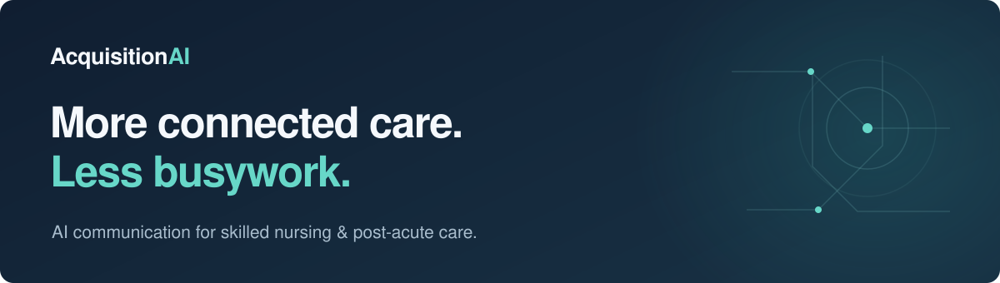

**AI communication and connected workflows for skilled nursing and post-acute care.**

A phone call can be a family connection, a clinical handoff, an admissions inquiry, or a request that needs attention. AcquisitionAI brings conversations and the work they create into one connected flow.

### From the first call to the next step

| Area | Our focus |
| :--- | :--- |
| **AI voice & routing** | Help callers reach the appropriate team with facility-specific context. |
| **Clinical communication** | Keep conversations and structured handoff information together for staff review. |
| **Facility operations** | Bring requests, ownership, and follow-up into a shared workspace. |

### Built around the people providing care

We design around staff review, clear responsibilities, and the way each facility operates. Technology should make more room for care.

Our product repositories are private. Visit our website to explore the platform, see illustrative workflows, or connect with our team.

---

[Explore AcquisitionAI](https://acquisitionai.com) &nbsp; · &nbsp; [About us](https://acquisitionai.com/about) &nbsp; · &nbsp; [LinkedIn](https://www.linkedin.com/company/acquisition-ai/)
